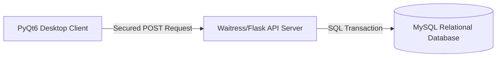

# Real-Time Fire and Smoke Detection and Tracking System Using YOLOv11, ByteTrack, and PyQt6

An integrated, real-time computer vision system for early fire and smoke hazard detection. The system features an optimized **YOLOv11** deep neural network deployed via **ONNX Runtime (FP16)**, a state-of-the-art **ByteTrack** multi-object tracking (MOT) algorithm, a highly responsive **PyQt6** desktop dashboard, and a production-grade **Flask (Waitress)** API backend coupled with a **MySQL** relational database.

This project is designed as an academic and practical implementation for early warning safety systems, accommodating simultaneous high-resolution camera feeds (local USB and RTSP IP cameras), delivering desktop notifications, playing acoustic alarms, and persisting visual event logs to a remote database.

---

## 🔬 Core Academic & Technical Features

1. **Model Optimization (FP16 ONNX Quantization):**
   To facilitate low-latency inference on edge devices or low-spec hardware, the trained YOLOv11 model is converted to half-precision (**FP16**) ONNX format. This reduces the memory footprint and accelerates inference speed while preserving high mean Average Precision (mAP).

2. **Stateful ByteTrack Multi-Object Tracking (MOT):**
   Rather than treating detection as disjointed frames, the system implements the **ByteTrack** algorithm. ByteTrack associates bounding boxes frame-by-frame utilizing a Kalman filter. Crucially, the tracking state is **isolated per camera stream** by running dedicated model instances, preventing tracking ID crossover or collision across multiple feeds.

3. **Dual-Class Confidence Filtering:**
   To address class imbalance and varying optical characteristics, the system decouples confidence thresholds:
   - **Fire Class Threshold:** Set higher (e.g., `80%`) to eliminate false positives from environmental lights, reflections, or red objects.
   - **Smoke Class Threshold:** Set lower (e.g., `40-50%`) to reliably capture diffuse, low-contrast, and semi-transparent smoke plumes.

4. **Temporal Cooldown Filtering:**
   An automatic 15-second alert lockout (`self.alert_cooldown = 15`) prevents database flooding. While live visualizations update continuously, database record insertions and acoustic alarms are throttled in the temporal domain.

5. **Ergonomic UI/UX Design (Charcoal Theme):**
   The PyQt6 dashboard uses a clean QSS-styled Charcoal Dark Theme, featuring an adaptive multi-column grid layout, status toolbars, and a database synchronization history panel.

---

## 📐 System Architecture



* **Client Node:** Python 3.9, PyQt6, OpenCV, Ultralytics YOLOv11, ONNX Runtime.
* **Server Node:** Flask, Waitress (WSGI Production Web Server), MySQL Connector (Pure Python Mode).
* **Database Node:** MySQL 8.0 Relational Database.

---

## 📊 Database Schema (`fire_screenshot`)

Event logs are persisted in the `fire_screenshot` table with the following schema:

| Column Name | Data Type | Description |
| :--- | :--- | :--- |
| `fire_id` | `INT (AUTO_INCREMENT)` | Primary key identifier |
| `camera` | `VARCHAR(50)` | Identifies the camera stream source |
| `photos` | `VARCHAR(255)` | Path to the saved annotated image artifact |
| `location` | `VARCHAR(100)` | Descriptive location or room name |
| `confidence_score` | `DECIMAL(5,2)` | Bounding box confidence accuracy (%) |
| `status` | `ENUM('fire', 'smoke', 'fire + smoke')` | Danger category classification |
| `waktu_kejadian` | `TIMESTAMP` | Server-side registration timestamp |

---

## ⚙️ Environment Setup & Installation

### 1. Prerequisites
* Python 3.9 (configured within a virtual environment).
* MySQL Server (running locally or remotely).

### 2. Clone the Repository
```bash
git clone https://github.com/username/repository-name.git
cd repository-name
```

### 3. Initialize Virtual Environment & Install Dependencies
```bash
python -m venv .venv
.venv\Scripts\activate
pip install -r requirements.txt
```

### 4. Database Restoration
1. Access your MySQL instance.
2. Initialize a database schema named `fire_detection`.
3. Import the provided SQL dump to initialize the schema:
   ```bash
   mysql -u root -p fire_detection < fire_detection_dump_2.sql
   ```

### 5. Environment Variables Configuration (`.env`)
Create a `.env` file in the root directory and configure the database credentials:
```env
DB_HOST=localhost
DB_USER=root
DB_PASSWORD=YourDatabasePassword
DB_NAME=fire_detection
URL_UPLOAD=http://127.0.0.1:5000/upload
URL_GET_HISTORY=http://127.0.0.1:5000/get_history
API_KEY=Create your own key, using API Key Generator
API_PORT=5000
CONFIDENCE_INITIAL_VALUE=80
```

---

## 🏃 Running the Application

Execute the unified batch script launcher to initiate the services:
```bash
run_app.bat
```
This launcher automates the following sequence:
1. Starts the Windows MySQL database service.
2. Deploys the Flask API using the `Waitress` WSGI server.
3. Launches the PyQt6 GUI dashboard.

---

## 📦 Executable Compilation (Deployment)

To compile the scripts into standalone Windows binaries using PyInstaller:

```bash
# Ensure active background tasks are terminated
taskkill /f /im Fire_photo.exe
taskkill /f /im api_server.exe

# Compile API Server
.venv\Scripts\pyinstaller --noconfirm api_server.spec

# Compile GUI Client
.venv\Scripts\pyinstaller --noconfirm Fire_photo.spec
```
The compiled, standalone portable packages are generated in the `dist/` directory.
